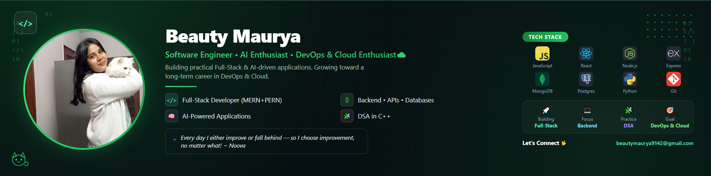

<!--   -->

<h2 align="center">Hey there 👋 I'm Nova (aka Beauty) 🐈‍⬛</h2>

<h3 align="center">
   Backend-Focused Software Developer | AI Automation 🤖
</h3>

  
  

---

### 👩‍💻 About Me

* 💻 BCA graduate with hands-on experience in software development and backend-focused projects.
* 🚀 Built projects involving **backend development, REST APIs, database integration, and automation**.
* 🧠 Interested in **backend engineering, system design, AI integration, and building practical applications**.
* ⚙️ Currently deepening my knowledge in **backend engineering** and working on **AI automation**.
* 📚 Practicing **DSA with C++** to improve my problem-solving skills.
* 🗣️ Continuously improving my communication and technical explanation skills.
* ☁️ Long-term goal: growing into **Cloud & DevOps** with **AI automation** as part of the journey.
* 💬 Ask me about: **JavaScript, Node.js, Express.js, REST APIs, MongoDB, Python, C++, and Git/GitHub**.
* 📫 Reach me at: **[beautymaurya9142@gmail.com](mailto:beautymaurya9142@gmail.com)**
* 😄 Fun fact: Debugging at 2am hits different when there's food involved 🍕

 

  
  

---
### 🛠️ Tech Stack

  

  
    JavaScript • TypeScript • Python • C++ • Node.js • Express.js • MongoDB • React • HTML • CSS • Tailwind CSS • Git • GitHub • Postman • Playwright • VS Code
  

---

### 🌱 Currently Learning

  `Backend Engineering` • `System Design` • `AI Automation`

---
### 🚀 Where I'm Heading

**Right now:** I'm focused on growing as a **Backend-Focused Software Developer**, building strong fundamentals in server-side development, API design, databases, and application architecture. Alongside that, I'm exploring **AI automation**, using AI to build smarter workflows and practical tools on top of solid backend systems.

**Long term:** I want to grow into **Cloud & DevOps Engineering**, where I can combine backend knowledge with deployment, automation, and reliable infrastructure, and bring **AI automation** into those workflows too.

Along the way, I'm working on becoming a better **problem-solver, communicator, and engineer**.

---

### 📊 GitHub Stats

  
  

---

 ### 📈 Contribution Insights 

 

  
  
  

 

  

 

---

### 🌐 Let's Connect

  
  &nbsp;&nbsp;

  
  &nbsp;&nbsp;

  
  &nbsp;&nbsp;

  
  &nbsp;&nbsp;

  

  📫 <strong>beautymaurya9142@gmail.com</strong>

---

<h3 align="center">
  ✨ Curious. Creating. Becoming. ✨
</h3>

<h3 align="center">
  Every day I either improve or fall behind — so I choose improvement, no matter what! 
  ~ Noova 🦋
</h3>
